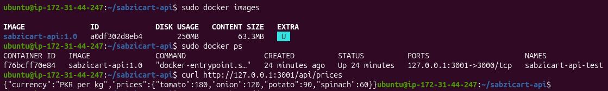

# Assignment 4: Deploy a Dockerized Node.js Application

## Project Overview

This assignment demonstrates how to containerize the SabziCart Node.js API using Docker and deploy it to an AWS EC2 instance.

The application is deployed on EC2, with Nginx configured as a reverse proxy to forward incoming requests to the Docker container.

## Docker Configuration

The application is containerized using the following Dockerfile:

```dockerfile
FROM node:22-alpine

WORKDIR /app

COPY package*.json ./

RUN npm ci --omit=dev

COPY server.js .

EXPOSE 3000

ENV NODE_ENV=production

CMD ["npm", "start"]
```

### Build Docker Image

```bash
docker build -t sabzicart-api:1.0 .
```

### Run Container Locally

```bash
docker run -d --name sabzicart-api -p 3000:3000 sabzicart-api:1.0
```

## EC2 Deployment

The Dockerized application was deployed to an AWS EC2 Ubuntu instance.

### Build Image on EC2

```bash
sudo docker build -t sabzicart-api:1.0 .
```

### Run Container on EC2

```bash
sudo docker run -d --name sabzicart-api-test --restart unless-stopped -p 127.0.0.1:3001:3000 sabzicart-api:1.0
```

The container listens on port `3000`, mapped to port `3001` on the EC2 host.


## Deployment Verification

The application was also tested through its configured domain:

**Domain:** https://sabzicart-api.duckdns.org

## Proof of Work

The following screenshot provides evidence of the successful deployment:


